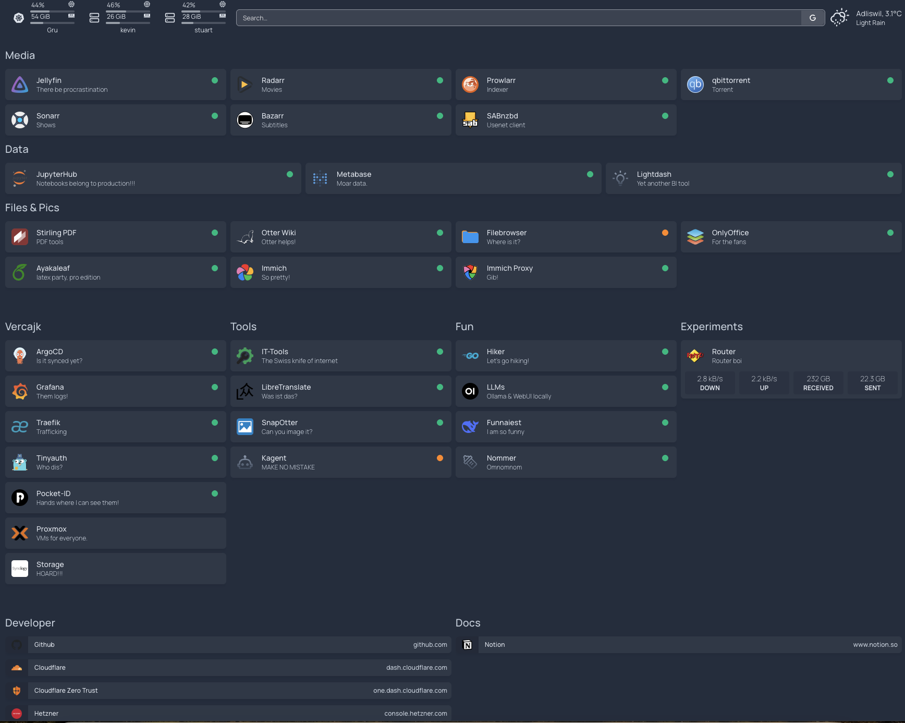
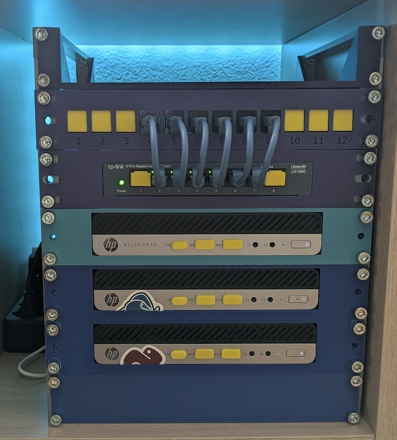

# Gru-Ops

This is my tiny homelab, running k8s with Talos OS and Proxmox, build from three mini PCs.

### Infra
- Cluster Management: `ArgoCD`, `Alloy`, `kube-prometheus-stack`, `loki`, `reflector`, `sealed-secrets`
- Database, Storage, Backup: `cnpg`, `csi-driver-nfs`, `docker-registry`, `k8up`, `csi-synology`
- Network & Access: `lets-encrypt`, `cloudflare tunnels`, `external-dns`, `metallb`, `pocket-id`, `tinyauth`, `traefik`
- `Hetzner` s3 for backup, `Cloudflare` for tunnels, domains and DNS.

### Apps
- Homepage, Immich, IT-Tools, JupyterHub, LibreTranslate, Jellyfin & arr-stack, Metabase, Lightdash, Ollama, Open-WebUI, OtterWiki, Podinfo, Stirling PDF, Ayakaleaf, Coco-in-a-Box, Filebrowser, Funnaiest, Hiker, Kagent, Kitchen Chaos, Nommer, OnlyOffice, Rill, SnapOtter


## Cluster

| Name   | Node                       | CPU                                                                  | RAM    | HDD          | Second HDD | OS             | Power |
|--------|----------------------------|----------------------------------------------------------------------|--------|--------------|------------|----------------|-------|
| Kevin  | HP EliteDesk 800 G3 Mini   | Intel Quad Core i5 7500 3,40 GHz (4 cores, 4 threads, 6MB cache)    | 40 GB  | 256 GB NVMe  | 500 GB SSD | Talos (master) | 65W   |
| Stuart | HP EliteDesk 800 G3 Mini   | Intel Quad Core i5 7500 3,40 GHz (4 cores, 4 threads, 6MB cache)    | 40 GB  | 256 GB NVMe  | 500 GB SSD | Talos (worker) | 65W   |
| Bob    | HP EliteDesk 800 G3 Mini   | Intel Quad Core i5 7600T 2.8GHz (4 cores, 4 threads, 6MB cache)     | 16 GB  | 256 GB NVMe  | N/A        | Proxmox        | 35W   |

<p align="center">
  
  
</p>

## Storage

`Synology DS920+` aka Choko
- Intel Celeron J4125 2.0 GHz *(4 cores, 4 threads, 4MB cache, 10W)*
- 4GB DDR4 RAM (added +8GB myself), two 1GbE ports, and two M.2 NVMe slots for SSD caching.
- 2x 4TB WD Red (WD40EFRX)

## Folder structure

```bash
.
├── argocd
│   ├── bootstrap
│   │   ├── kustomization.yaml
│   │   ├── namespace.yaml
│   │   └── README.md
│   ├── manifests
│   │   └── prod
│   │       ├── apps
│   │       └── infra
│   ├── prod
│   │   ├── apps
│   │   │   ├── ayakaleaf.yaml
│   │   │   ├── coco-in-a-box.yaml
│   │   │   ├── filebrowser.yaml
│   │   │   ├── funnaiest.yaml
│   │   │   ├── hiker.yaml
│   │   │   ├── homepage.yaml
│   │   │   ├── immich.yaml
│   │   │   ├── it-tools.yaml
│   │   │   ├── jellyfin.yaml
│   │   │   ├── jupyter.yaml
│   │   │   ├── kagent-crds.yaml
│   │   │   ├── kagent.yaml
│   │   │   ├── kitchen-chaos.yaml
│   │   │   ├── libretranslate.yaml
│   │   │   ├── lightdash.yaml
│   │   │   ├── media-arr.yaml
│   │   │   ├── metabase.yaml
│   │   │   ├── nommer.yaml
│   │   │   ├── ollama.yaml
│   │   │   ├── onlyoffice.yaml
│   │   │   ├── open-webui.yaml
│   │   │   ├── otterwiki.yaml
│   │   │   ├── podinfo.yaml
│   │   │   ├── rill.yaml
│   │   │   ├── snapotter.yaml
│   │   │   └── stirling.yaml
│   │   ├── apps.yaml
│   │   ├── infra
│   │   │   ├── argocd.yaml
│   │   │   ├── cert-manager.yaml
│   │   │   ├── cloudflare.yaml
│   │   │   ├── cnpg.yaml
│   │   │   ├── csi-driver-nfs.yaml
│   │   │   ├── docker-registry.yaml
│   │   │   ├── external-dns.yaml
│   │   │   ├── k8up.yaml
│   │   │   ├── metallb.yaml
│   │   │   ├── monitoring.yaml
│   │   │   ├── pocket-id.yaml
│   │   │   ├── reflector.yaml
│   │   │   ├── sealed-secrets.yaml
│   │   │   ├── synology.yaml
│   │   │   ├── tinyauth.yaml
│   │   │   └── traefik.yaml
│   │   └── infra.yaml
│   ├── project.yaml
│   ├── README.md
│   └── root-app.yaml
├── assets
│   ├── homepage.png
│   └── server.png
├── aux
│   ├── seal-secret.sh
│   ├── sealed-secrets-public.crt
│   └── synology-client-info.yml
├── docs
│   └── restore
│       ├── RESTORE_PLAN.md
│       ├── restore-bazarr.yaml
│       ├── restore-jellyfin.yaml
│       ├── restore-prowlarr.yaml
│       ├── restore-qbittorrent.yaml
│       ├── restore-radarr.yaml
│       ├── restore-sabnzbd.yaml
│       └── restore-sonarr.yaml
├── README.md
├── renovate.json
└── terraform
    ├── cluster.tf
    ├── modules
    │   └── proxmox-vm
    │       ├── main.tf
    │       ├── outputs.tf
    │       └── variables.tf
    ├── patches
    │   ├── controlplane.yaml
    │   ├── hostname.yaml
    │   ├── worker_bob.yaml
    │   └── worker_stuart.yaml
    ├── providers.tf
    ├── README.md
    ├── s3-backup.tf
    └── variables.tf
```
